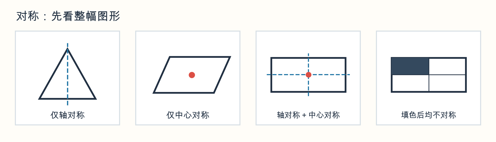
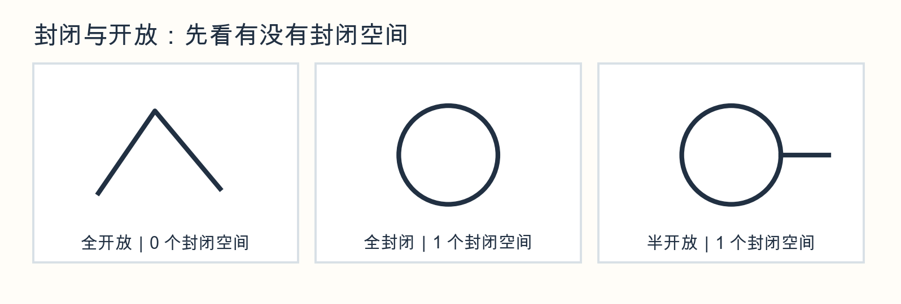
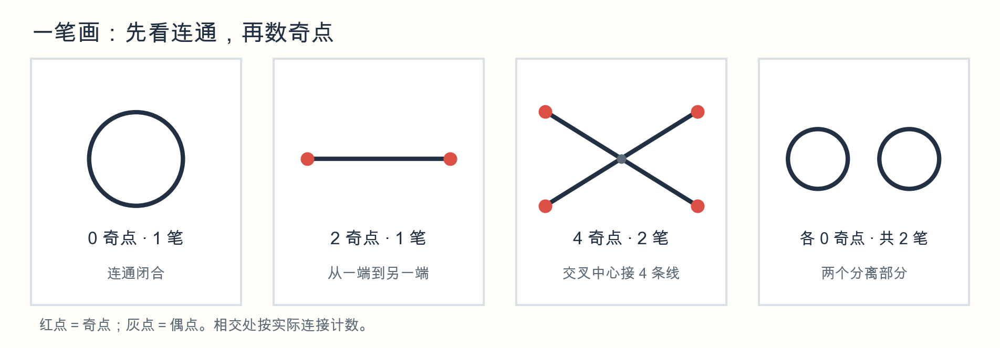
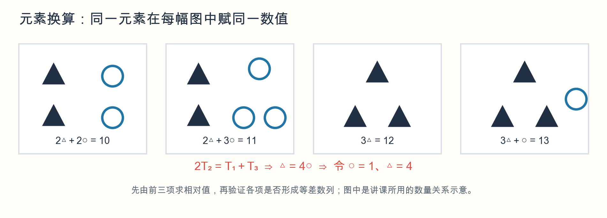

# 图形推理01｜定性分析与点线面

本讲讨论平面图推。看题时记住：**题干找共性，选项找差异，整体判方向，细节猜心思**。先看整组图形的共同特征，再用选项差异缩小考点；“图形凌乱偏定性、规整且数量有变化偏定量、基本图形相同偏位置”只是选方向的提示，仍须逐图验证。

课程把常见规律分为**定性分析、定量分析、位置分析**。定性口诀为“屈臣氏整奇偶风”：曲直、对称、相同相似、整体部分、奇偶、封闭开放；定量按“点线面角数”检查。本讲重点是定性与点、线、面，角和元素只讲入门。另从图形特征提示“四大类”：背景图、分割图、对称图、汉字图；以及“六提示”：平行、圆、一笔画、连接方式、直角、数量加减，后续再展开。

## 一、定性分析：屈臣氏整奇偶风

### 1. 屈：曲线与直线

- **有无曲线**：一组全有曲线，另一组全无曲线。
- **曲直组成**：全曲、全直、曲直混合；不要把“有曲线”与“全曲线”混为一谈。
- **曲直关系**：直线与曲线相交、相切或相离。出现圆、圆弧时可留意这一关系。
- 曲线的**数量**属于后面的“线”考点；题干强调数量变化时再数。

### 2. 臣：对称

先看**轴对称、中心对称、两者兼有、均不对称**。中心对称是旋转 $180^\circ$ 后重合；判断须把阴影、颜色也算进整幅图形，不能只看外轮廓。

老师将考点分成“三大哥、三小弟”：

1. **三大哥**：对称性质；对称轴的条数；对称轴的方向。规则三角形、正方形、正五边形、正六边形可分别提示 $3、4、5、6$ 条轴，但仍要检查内部图案。
2. **三小弟**：对称轴过点、过线、过面；多条对称轴之间的方向关系（如平行、垂直或夹角）；组合图形的整体对称。这里“过线”看轴是否与图中线段重合，“过面”看轴穿过的封闭区域，不把单纯垂直相交误判为过线。

先检验题干每幅图是否都满足所选对称规律，再核对选项；不要因为一两幅图“看着像”就强行分类。

### 3. 氏／似：相同相似

1. **图图之间有共同元素**：每幅图都藏着同一种形状；大小、朝向、位置可以不同。
2. **单图内部有相同或相似元素**：如内部出现两个相同图形，或内外轮廓形状相似；“相似”不要求尺寸相同。
3. **相邻图形传递元素**：前后两图保留同一元素，再观察它出现的位置。

形状杂乱但有特别醒目的局部，如三角形的“眼睛”“鼻子”，可先找共同的局部元素。

### 4. 整：整体与部分

看图形是**一个连通整体**还是由多个彼此分离的部分组成；必要时数部分个数。真正相交或接触后可连通，彼此不接触的内外图形仍是两部分。若某幅图的点、线过多且难数，可先检查整体与部分的性质。

### 5. 奇偶：数量的奇偶性

当图中某种元素可以计数（点、线、封闭空间等），可试着按**奇数与偶数**分组，尤其留意六图分类是否形成三与三。须明确“数的是什么”，并验证两组各自的正面共同特征，不因凑得出奇偶就忽略更直接的规律。

### 6. 风／封：封闭与开放

- **全开放**：没有封闭空间。
- **全封闭**：图形由封闭线条构成，没有向外伸出的开放线段。
- **半开放／半封闭**：有封闭空间，同时有向外伸出的开放线段。

题目有时只区分**有无封闭空间**，这时不必继续区分全封闭和半封闭。若封闭空间数本身呈规律，再转入“面”计数。

## 二、定量分析：点、线、面

### 1. 点：交点及特殊点

线条和交叉明显增多时，先数**所有交点**；若总交点数不成规律，再按题目特征细化：

1. **曲直交点**：曲线与直线的交点，也要区分相交与相切。
2. **十字交点**：两条线交叉形成十字，可结合是否垂直判断。
3. **切点**：两条线相切的接触点。
4. **内部交点**：特定封闭图形或圆圈内部的交点。
5. **外框／轮廓上的交点**：只数落在外轮廓上的交点。
6. **拐点处的标记**：题图若有黑点、标记点，留意它落在拐角还是直线段上。

画面以圆为界时，也可比较圈内、圈外的点数。先统一计数口径，再检查题干和选项，不把切点算成两个交点。

### 2. 线：线段数与笔画数

常见入口有**直线数、曲线数、横线数、竖线数、内外线数、连接处的线段数、笔画数**。规整多边形可数外边；有曲线的字母、笑脸等可数曲线。若各图横、竖线的绝对数量变化杂乱，可比较两者是否相等或有固定差值；若有内外两层，也可看数量的和、差。题图特别标出一个点时，可数从该点发出的线段（射线）。

**一笔画的提示**：出头、T 形接点、分离部分，以及“日、田、五角星、车标”等特殊图形。见到提示后仍应数奇点、核对连通性，不能仅凭图案名称判断。

**奇点**是与奇数条线段相接的点：单线端点接 $1$ 条，T 形点接 $3$ 条，少见的点可接 $5$ 条。X、K 形交叉若接 $4$ 条，则不是奇点；弯折成 Y 形的三岔点仍是奇点。数时可沿外轮廓先找出头和 T 形点，必要时再检查内部；若已找到超过 $2$ 个奇点，便可排除一笔画，无须为此数尽其余点。

对于**一个连通图形**：奇点数只能为偶数；有 $0$ 或 $2$ 个奇点时可一笔画。$0$ 个可任选一点起笔并回到该点；$2$ 个须从其中一个奇点起笔，到另一个奇点收笔。多于 $2$ 个时，最少笔画数为奇点数的一半；$0$ 个奇点的连通图形仍需 **1 笔**。图形若分离，应对每个连通部分分别计笔画后相加，分离的圆圈不能“捏没”。

**吹捏法（补讲）**：对只通过一个连接点接入其余线条的封闭轮廓，可想象把它缩到该连接点；走到连接点后绕轮廓一圈又回到原点，不会额外占一笔。封闭轮廓少、连接关系清楚时可快速简化；复杂或共边图形宜直接数奇点。吹捏时须保留原来的连通关系，**共用的线段不能在两个封闭轮廓中重复消去**；彼此分离的封闭图形各需一笔。

### 3. 面：封闭空间与面积

先数**封闭空间总数**，必要时再数其中某种特定形状（如三角形）或相同区域的个数。阴影面积题比较黑白面积或所占比例，可用分割、拼接判断相等、二分之一、三分之一等，不必一开始就求具体面积。封闭区域很多时，先按题目中的明显分割线逐块计数，避免漏掉小区域。

### 4. 角、元素：本讲的提示

**角**可数直角、锐角等；出现刻意改动的多边形或明显直角时，优先查直角数。**元素换算**适用于由两种元素组成、各元素可赋一个固定数值，且赋值后的总量呈等差变化的图形：先取连续三项，利用 $2T_2=T_1+T_3$ 求两种元素的相对数值，再把较小的值设为 $1$，验证整组后选择下一项。例如推出“$1$ 个三角形＝$4$ 个圆”后，可将圆记 $1$、三角形记 $4$，逐图计算总值。等差关系须与整组图形相符。

## 三、做题节奏

日常练习宜混合规律，避免只练刚学过的单一题型。考场遇到一时无从下手的图形，先跳过，分轮处理，勿长时间盯住一题；老师建议第一轮几分钟内先拿下明显题，后续再回看难题。每题先确定**看性质、数数量还是看位置**，再从最明显的提示点切入。

## 参考来源

- 《20250728 判断-图推1》课程转写稿。
- 《20250728 图推一笔画奇点查找+吹捏法》补讲转写稿。
- 桌面“花生13行测/图推/01”中的《笔记*.png》课堂截图。
- 文内图解依据课堂概念绘制；元素换算图沿用课堂示例的数量关系，均非真题原图。
