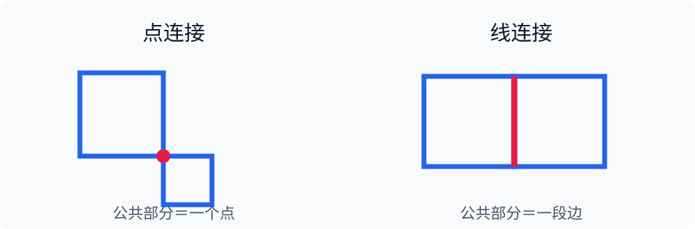
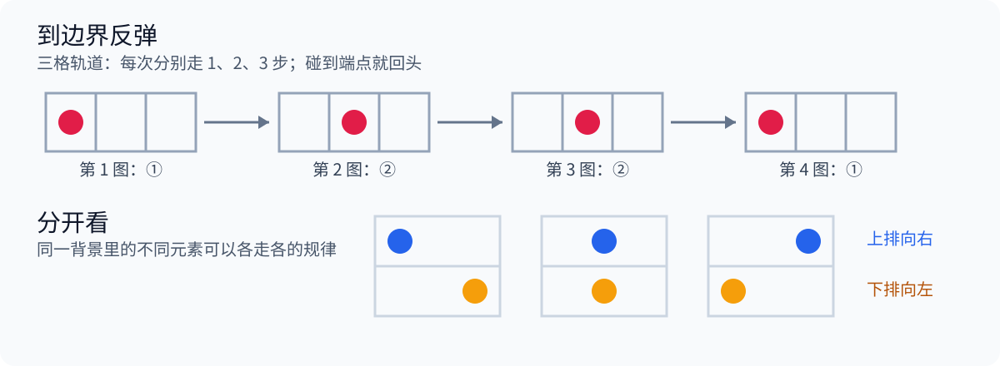
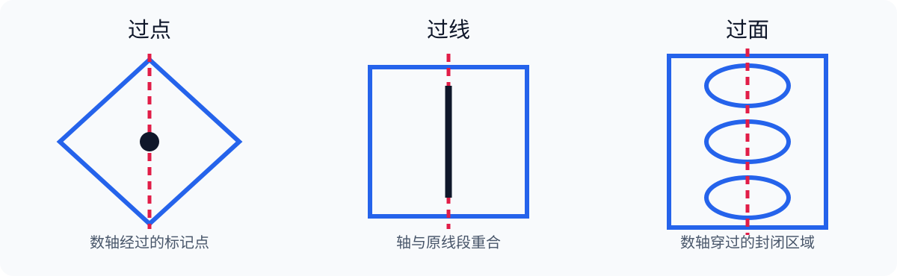

# 图形推理02｜角、元素、位置与对称图

本讲接续 [[图形推理01-定性分析与点线面|第一课]]：补齐“点线面角数”的**角、数（元素）**，展开位置分析口诀**“直接想位移”**，最后进入“四大类”中的**对称图类**。规律只是切入提示；对题干每幅图、每行或每列逐一验证，再比选项。

## 一、定量分析：角与元素

### 1. 角：优先看直角

角可数直角、锐角、钝角，本讲以**直角**为重点。提示图形有直角三角形、垂线、直角梯形、矩形，以及剪去矩形一角的“**电话卡**”（由四个直角变成三个）。图形若有刻意补线、削角或把笔画改斜，留意它在**制造或消去直角**。两条线夹成角，外侧可辨认的角也要纳入同一计数口径；T 形垂线可形成两个直角，十字交叉可形成四个直角。

数角前先定：是数全图，还是数题干反复出现的**某两条线之间**；数直角还是某一类锐角、钝角。课堂一题的直角数依次为 $8、7、6、5、4$，据此在选项中找 $3$ 个直角。若图形特意修正形状，要看修正改变了什么，不靠图案名称猜。

### 2. 数：元素的种类、个数、换算、遍历

- **种类**：不同形状有几种；同一种元素出现三次仍只算一种。方向不同但形状相同，通常仍算同一种。
- **个数**：总个数、某一种元素的个数，或各类个数的组合；也可比较圈内、圈外同类元素的种类与个数。
- **换算**：题干主要由两种元素组成，两类数量此消彼长且总值疑似等差时，用连续三项的 $2T_2=T_1+T_3$ 求相对权重，再逐图验算。课堂例中推出“一个圆＝两个三角形”，可令三角形为 $1$、圆为 $2$，得到 $2、5、8、11$，下一项应为 $14$。这与第一课的元素换算相接。
- **遍历**：在每行或每列，各类元素、位置或黑白状态按固定次数出现。先分别检查每种元素与位置，再合起来筛选；不能只补对元素却放错位置。

“相同相似元素”属定性；“种类、个数、换算、遍历”属此处的元素计数。定量还可与定性、位置结合。课堂复盘的“点线面角数”也补充：点可分曲直、直直、十字、切点及轮廓内外上；线可看连接处线段数、两个标记之间的线段数、从标记点发出的线段数；面可看封闭空间数、相同面数和面积。

## 二、位置分析：“直接想位移”

图形样式基本相同、出现固定背景或棋盘、位置或朝向在变化时，按**直—接—想—位—移**查看。

### 1. 直：垂直平行

看特征线之间**平行还是垂直**，或数**平行线组数**。两两平行的提示有相似三角形、矩形、平行四边形，以及经补线形成平行四边形的梯形；一个矩形有横、竖两组平行线。立体图中，两线虽不相交，若一条垂直于另一条所在的平面，仍与该面内那条线垂直。

### 2. 接：连接方式

以两个图形的**公共部分**判定：只在一个点接触为点连接，共用一段边为线连接；不要把“用一根线把两图连起来”直接当线连接。进一步查连接处**特征**（公共边是长边还是短边、等长重合、被包含或交错）及连接处**线段数**。简笔画式图形可先留意连接方式。

### 3. 想：方向

可看**对称轴方向**、两图连线或特征线的方向；连续折线像“贪吃蛇”时，看**首尾线段**是平行还是垂直。若一端改为曲线，也可能转为数两条曲线之间的直线段。方向、轴数可同时考，逐项核对。

### 4. 位：位置关系

有明显的黑点、小圆等**标志点／物**，看它落在顶点、交点、边中部、某条边、某个角旁，或从外到内的第几条线段上。多个标志物时，比较二者隔一个还是隔两个图形等**相对位置**。标志点个数不固定，可先寻找共有的位置性质；位置可能随可数元素的奇偶性变化。课堂例：方块数为奇数时黑点在中间，偶数时在最下方。

### 5. 移：移动、旋转、翻转、叠加

- **移动**：左右、上下、圆周、内外圈均可能；步数可固定、递增、循环，也可到边界后**反弹**。先锁定一个标志物，逐图追踪；不同颜色、内外圈或上下两块可**分开看**，各按自己的规则移动。点突然“消失”，检查是否与另一元素重合。
- **旋转与翻转**：旋转检查方向和角度，翻转检查左右或上下镜像。能从第 1 图与第 3 图直接看出镜像关系时，可跨图比较；若同题还出现大小变化，也需逐图核对。
- **叠加**：两图按对应位置重合，可能“**去同存异**”“**去异存同**”，也可能自定义黑白运算（黑＋黑、黑＋白、白＋黑、白＋白各是什么须由题干定）。九宫格先试行，某行不成立就试列；观察能区分选项的局部，不必把整幅复杂图先画完。叠加后还可能旋转、翻转；课堂建议**先叠加，再看结果是否转动**，避免先转原图而转乱。

## 三、四大类：本讲先讲对称图类

四大类的提示是**对称图、背景图、分割图、汉字图**。本讲只展开对称图；其余三类先识别外观，不把后续课的规律提前写进来。出现 Z、S、风车、太极、平行四边形等中心对称提示图，或规整的轴对称图，可进入下面的检查。

### “三大哥”：性质、数量、方向

1. **性质**：轴对称、中心对称、两者兼有或均不对称；组合图还可分别辨别各组成图形的性质。九宫格可能每行、每列各有一种。
2. **数量**：数整幅图的对称轴，不只看外轮廓。正三角形、正方形、正五边形、正六边形分别提示 $3、4、5、6$ 条轴，但附加元素可能减少轴数。
3. **方向**：单轴图尤其容易看轴的方向与旋转；若同时涉及轴数，二者都要满足。

### “三小弟”：过点过线过面、位置关系、整体对称

1. **过点、过线、过面**：画出对称轴，看它经过原图的交点或黑点、与原图某段线重合、穿过几个封闭面。“过线”指与原线段**重合**；仅垂直相交属于另一种位置关系。可按经过的点数、面数分类。
2. **位置关系**：图中有两个或以上轴对称部件时，分别画轴，查两轴平行、垂直、相交及夹角。
3. **整体对称**：把选项填入后检查整幅组合图是否呈轴对称或中心对称，不只检查单块。

## 考场识别顺序

先找整组最突出的提示：有明显直角修正，查角；两类元素此消彼长，查换算；样式近似或有背景，查位置；有规整或中心对称提示图，查对称轴。分类题要给两组各找一个**正面共同特征**；九宫格每行或每列都要成立。某种解释只匹配前两图或一行时，继续试其他方向，不在难题上久耗。

## 参考来源

- 《20250729 判断-图推2》课程转写稿。
- 桌面“花生13行测/图推/02”中的《笔记*.png》《位置分析总结.png》《定性分析笔记总结.png》《对称类-*.png》《分开看.png》《反弹.png》课堂截图。
- 文内示意图依据课堂概念绘制，均非真题原图。
